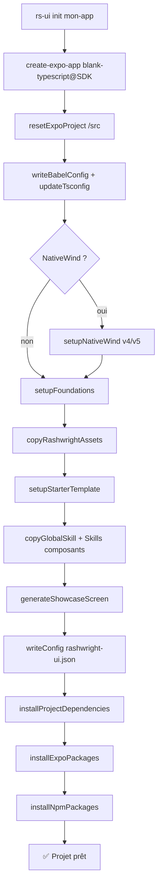
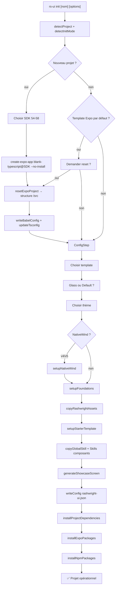
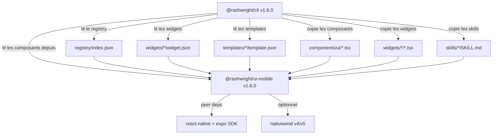

# Architecture Rashwright UI Mobile — `rs-ui init` & Moteur de Widgets

> Généré par Rashwright CLI v1.6.0 · Mis à jour pour v1.6.0

Ce document décrit formellement les architectures de chaque mode d'initialisation disponible avec la commande `rs-ui init`, ainsi que la nouvelle couche de **Widgets Modulaires Autonomes** introduite en v1.6.0. Il sert de référence pour l'outil CLI, la documentation et les contributions.

---

## Table des matières

1. [Vue d'ensemble des modes d'init](#vue-densemble)
2. [Architecture A — Nouveau projet Expo Router `/src`](#architecture-a)
3. [Architecture B — Projet Expo Router existant](#architecture-b)
4. [Architecture C — Classic App.tsx (sans Expo Router)](#architecture-c)
5. [Templates disponibles (10 templates)](#templates)
   - [Showcase (défaut)](#template-showcase)
   - [Minimal Starter](#template-minimal)
   - [Auth Suite](#template-auth)
   - [Onboarding Flow](#template-onboarding)
   - [Dashboard & Analytics](#template-dashboard)
   - [E-Commerce & Store](#template-commerce)
   - [Settings & Preferences](#template-settings)
   - [Finance & Wallet](#template-finance)
   - [Chat & Social](#template-chat)
   - [Social Feed](#template-social)
6. [Widgets Modulaires Autonomes (6 widgets v1.6.0)](#widgets)
   - [MetricWidget](#widget-metric)
   - [ProgressWidget](#widget-progress)
   - [QuickActionsWidget](#widget-quick-actions)
   - [ChartWidget](#widget-chart)
   - [ActivityFeedWidget](#widget-activity-feed)
   - [FinanceWidget](#widget-finance)
7. [Showcases d'intégration (2 dashboards)](#showcases)
8. [Dépendances communes](#dependances)
9. [NativeWind v4 vs v5](#nativewind)
10. [Flux d'initialisation CLI](#flux-cli)
11. [Schéma des dépendances inter-packages](#schema-des-dependances-inter-packages)

---

## Vue d'ensemble des modes d'init {#vue-densemble}

```
rs-ui init [project-name]
  │
  ├─ Mode A : nouveau-projet (create-expo-app + reset + /src)
  │   └─ Architecture Expo Router standardisée
  │
  ├─ Mode B : projet existant avec Expo Router détecté
  │   └─ Injection Rashwright dans app/ ou src/app/
  │
  └─ Mode C : projet existant Classic (App.tsx)
      └─ Injection Rashwright dans components/ ou src/components/
```

L'outil CLI détecte automatiquement le mode via `detectProject()` et `detectInitMode()` dans `packages/cli/src/core/project-detector.ts`.

---

## Architecture A — Nouveau projet Expo Router `/src` {#architecture-a}

**Déclenché par** : `rs-ui init <nom>` quand aucun projet existant n'est détecté, ou `rs-ui init .` dans un dossier vide.

### Structure générée

```
<project>/
├── src/
│   ├── app/
│   │   ├── _layout.tsx          # Root layout Expo Router (Provider ThemeProvider + GlobalStore)
│   │   ├── (tabs)/              # Groupe d'onglets (si template Dashboard/Commerce)
│   │   │   ├── _layout.tsx
│   │   │   └── index.tsx
│   │   └── index.tsx            # Écran principal (template sélectionné)
│   ├── components/
│   │   ├── ui/                  # Composants Rashwright installés
│   │   │   ├── index.ts         # Barrel export de tous les composants
│   │   │   ├── button.tsx
│   │   │   ├── card.tsx
│   │   │   ├── glass-card.tsx   # (si Glass activé)
│   │   │   └── ...              # Composants du template choisi
│   │   └── templates/
│   │       └── <template>/      # Fichiers du template (commerce/, auth/, etc.)
│   ├── contexts/
│   │   └── theme-context.tsx    # ThemeProvider + useTheme hook
│   ├── stores/
│   │   └── theme-store.ts       # Zustand store pour le thème
│   ├── theme/
│   │   ├── index.ts             # Export du thème actif
│   │   ├── tokens.ts            # Design tokens (spacing, radius, typography)
│   │   ├── themes/
│   │   │   ├── default.ts       # Thème Rashwright Blue (light + dark)
│   │   │   ├── emerald.ts       # Thème Emerald Mint
│   │   │   ├── violet.ts        # Thème Violet Tech
│   │   │   └── custom.ts        # (si thème custom configuré)
│   │   └── glass-theme.ts       # Tokens Glass UI (si mode Glass activé)
│   ├── constants/
│   │   └── glass-theme.ts       # createGlassTheme() helper
│   ├── lib/
│   │   ├── responsive.ts        # Hooks responsifs (useResponsive, useBreakpoint)
│   │   └── primitives/          # Primitives headless (usePressable, useToggle...)
│   ├── hooks/                   # Hooks personnalisés
│   │   └── use-glass-state.ts   # (si Glass activé)
│   └── assets/
│       ├── svg/primary.svg      # Logo Rashwright SVG
│       └── primary.png          # Logo Rashwright PNG
├── assets/                      # Assets Expo natifs
├── skills/
│   └── rs-ui/                   # Skills IA (si --skills non désactivé)
│       ├── SKILL.md             # Skill IA global Rashwright
│       └── components/          # Skills par composant
├── app.json                     # expo.web.bundler = "metro", plugins
├── babel.config.js              # babel-preset-expo + Reanimated plugin
├── metro.config.js              # getDefaultConfig + withNativeWind (si NW)
├── tsconfig.json                # paths alias @/ → src/
├── nativewind-env.d.ts          # (si NativeWind activé)
├── global.css                   # (si NativeWind activé)
├── rashwright-ui.json           # Configuration Rashwright
└── rashwright-ui.lock           # Lockfile des composants installés
```

### Dépendances installées

| Groupe | Packages |
|--------|----------|
| **Expo (via `expo install`)** | `expo-router`, `react-native-screens`, `expo-constants`, `expo-linking`, `react-dom`, `react-native-web`, `expo-system-ui`, `react-native-reanimated`, `react-native-gesture-handler`, `react-native-safe-area-context`, `@expo/vector-icons`, `expo-haptics`, `expo-image`, `@react-native-async-storage/async-storage`, `expo-image-picker`, `expo-image-manipulator`, `expo-application`, `expo-device`, `expo-blur`, `expo-linear-gradient` |
| **NPM** | `zustand` |
| **NativeWind v4** (optionnel) | `nativewind@4.2.7`, `tailwindcss@^3.4.17` |
| **NativeWind v5** (optionnel) | `nativewind@5.0.0-rc.0`, `react-native-css@3.1.0-rc.0`, `tailwindcss@4.1.12`, `@tailwindcss/postcss@4.1.12`, `postcss`, `lightningcss@1.30.1` |

### Flux de création



### tsconfig.json paths

```json
{
  "compilerOptions": {
    "baseUrl": ".",
    "paths": {
      "@/*": ["./src/*"]
    }
  }
}
```

---

## Architecture B — Projet Expo Router existant {#architecture-b}

**Déclenché par** : `rs-ui init` dans un dossier contenant déjà un projet avec Expo Router (`app/` ou `src/app/` détecté).

### Différences avec Architecture A

- Pas de `create-expo-app` → le projet est déjà initialisé
- Reset conditionnel (demande confirmation si template Expo par défaut détecté)
- Les composants sont injectés dans le chemin `componentsPath` existant ou choisi
- Le fichier `_layout.tsx` est modifié pour injecter `ThemeProvider` et `GestureHandlerRootView`
- Les imports `global.css` sont injectés en tête de `_layout.tsx` (si NativeWind)

### Structure attendue en entrée

```
<projet-existant>/
├── app/                   # ou src/app/
│   ├── _layout.tsx        # → ThemeProvider + GestureHandlerRootView injectés
│   └── index.tsx          # → peut être remplacé par le starter template
├── package.json           # Expo + React Native présents
└── ...
```

### Injection Rashwright

Le CLI détecte `hasExpoRouter: true` dans `detectProject()` et :
1. Identifie `app/_layout.tsx` ou `src/app/_layout.tsx`
2. Injecte les providers ThemeProvider en wrappant le layout existant
3. Copie les composants du template dans le chemin `componentsPath`

---

## Architecture C — Classic App.tsx (sans Expo Router) {#architecture-c}

**Déclenché par** : `rs-ui init` dans un projet Expo sans Expo Router (structure `App.tsx` classique).

### Structure générée

```
<project>/
├── App.tsx                # Modifié pour wrapper ThemeProvider + composants
├── components/
│   └── ui/               # Composants Rashwright (ou src/components/ui/)
├── contexts/
│   └── theme-context.tsx
├── stores/
│   └── theme-store.ts
├── theme/
│   └── ...
└── ...
```

### Différences

- Pas d'Expo Router → pas de `app/` directory
- L'écran starter est écrit dans `App.tsx` directement
- Pas de routes multi-écrans automatiques (routes manuelles via React Navigation si besoin)

---

## Templates disponibles {#templates}

Tous les templates sont dans `packages/ui-mobile/templates/` et définis dans `packages/cli/src/core/templates-manager.ts`.

---

### Template : Showcase {#template-showcase}

**Usage** : `rs-ui init --template showcase` (défaut)

**Description** : Vitrine complète de tous les composants Rashwright avec onglets Overview / Composants / Glass.

**Composants installés** : `button`, `card`, `glass-card`, `badge`, `text-input`, `rashwright-logo`, `avatar`, `stat-card`

**Écrans générés** :
```
app/index.tsx  →  ShowcaseTemplate (onglets overview/composants/glass)
```

**Fichiers template** :
```
templates/showcase/
├── template.json
├── showcase-template.tsx     # ShowcaseTemplate component
└── index.ts
```

---

### Template : Minimal Starter {#template-minimal}

**Usage** : `rs-ui init --template minimal`

**Description** : Écran épuré avec logo, card, badges et boutons.

**Composants installés** : `button`, `card`, `badge`, `rashwright-logo`

---

### Template : Auth Suite {#template-auth}

**Usage** : `rs-ui init --template auth`

**Description** : Suite complète d'authentification.

**Composants installés** : `button`, `card`, `text-input`, `badge`, `otp-input`, `form`, `rashwright-logo`

**Écrans générés** :
```
app/sign-in.tsx      →  SignInScreen
app/sign-up.tsx      →  SignUpScreen
app/otp-verify.tsx   →  OtpVerifyScreen
app/forgot.tsx       →  ForgotPasswordScreen
```

**Fichiers template** :
```
templates/auth/
├── template.json
├── types.ts
├── auth-template.tsx
├── index.ts
└── components/
    ├── social-auth.tsx
    └── password-input.tsx
```

---

### Template : Onboarding Flow {#template-onboarding}

**Usage** : `rs-ui init --template onboarding`

**Description** : Slides animés d'onboarding avec carousel et CTAs.

**Composants installés** : `button`, `badge`, `carousel`, `rashwright-logo`

---

### Template : Dashboard & Analytics {#template-dashboard}

**Usage** : `rs-ui init --template dashboard`

**Description** : Dashboard avec StatCards, métriques et profil.

**Composants installés** : `button`, `card`, `glass-card`, `badge`, `stat-card`, `avatar`, `data-table`, `rashwright-logo`

**Écrans générés** :
```
app/(tabs)/index.tsx        →  DashboardHome
app/(tabs)/analytics.tsx    →  AnalyticsScreen
app/(tabs)/profile.tsx      →  ProfileScreen
```

---

### Template : E-Commerce & Store {#template-commerce}

**Usage** : `rs-ui init --template commerce`

**Description** : Boutique avec catalogue, filtres et panier.

**Composants installés** : `card`, `button`, `badge`, `rating`, `rashwright-logo`

**Fichiers template** :
```
templates/commerce/
├── template.json
├── types.ts                  # Product, CartItem, CommerceTemplateProps
├── commerce-template.tsx     # CommerceTemplate (FlatList produits, filtres catégories)
├── index.ts
└── components/
    ├── product-card.tsx      # ProductCard (Card + Rating + Button)
    └── category-filter.tsx   # CategoryFilter (ScrollView horizontal + Badge)
```

---

### Template : Settings & Preferences {#template-settings}

**Usage** : `rs-ui init --template settings`

**Description** : Page paramètres avec profil, dark mode et notifications.

**Composants installés** : `card`, `avatar`, `button`, `divider`, `badge`, `rashwright-logo`

**Fichiers template** :
```
templates/settings/
├── template.json
├── types.ts                  # UserProfile, SettingsSection, SettingsTemplateProps
├── settings-template.tsx     # SettingsTemplate
├── index.ts
└── components/
    ├── profile-section.tsx   # ProfileSection (Avatar + Badge rôle + bouton Modifier)
    └── preferences-section.tsx # PreferencesSection (Switch dark mode/notifications)
```

---

### Template : Finance & Wallet {#template-finance}

**Usage** : `rs-ui init --template finance`

**Description** : Wallet, transactions et statistiques financières.

**Composants installés** : `card`, `glass-card`, `button`, `badge`, `stat-card`, `rashwright-logo`

---

### Template : Chat {#template-chat}

**Usage** : `rs-ui init --template chat`

**Description** : Interface de messagerie avec bulles, avatars et input.

**Composants installés** : `card`, `avatar`, `text-input`, `button`, `badge`

---

### Template : Social Feed {#template-social}

**Usage** : `rs-ui init --template social`

**Description** : Feed social avec posts, likes et profils.

**Composants installés** : `card`, `avatar`, `button`, `badge`, `stat-card`

---

## Widgets Modulaires Autonomes (v1.6.0) {#widgets}

Les widgets constituent une couche intermédiaire entre les composants UI atomiques (`Button`, `Card`, `Badge`) et les templates de pages complètes (`Auth`, `Dashboard`). Ils sont distribuables individuellement via `rs-ui add -w <id>` ou `rs-ui widget add <id>` et installés dans `src/components/widgets/<id>/`.

```
src/components/widgets/
├── metric/             # MetricWidget
├── progress/           # ProgressWidget
├── quick-actions/      # QuickActionsWidget
├── chart/              # ChartWidget
├── activity-feed/      # ActivityFeedWidget
└── finance/            # FinanceWidget
```

Chaque widget contient :
- `widget.json` : manifeste avec id, version, composants atomiques requis (`requiresComponents`), dépendances Expo et options Liquid Glass.
- `types.ts` : interfaces TypeScript strictes sans aucun `any`.
- `<id>-widget.tsx` : implémentation autonome respectant le thème clair/sombre et le mode Liquid Glass.
- `index.ts` : barrel export pour consommation propre par l'application.

### MetricWidget {#widget-metric}
- **Usage** : `rs-ui add -w metric`
- **Description** : Carte KPI pour indicateurs statistiques clés (ex: revenus, conversion, visiteurs). Affiche une valeur formatée, un badge de tendance animé (positive, négative, neutre avec pourcentage), une icône contextuelle, une mention temporelle et un état de chargement skeleton.
- **Composants requis** : `card`, `badge`

### ProgressWidget {#widget-progress}
- **Usage** : `rs-ui add -w progress`
- **Description** : Jauge de progression vers un objectif avec calcul automatique du pourcentage, barre animée avec spring, jalons intermédiaires et état de complétion visuel.
- **Composants requis** : `card`, `progress`

### QuickActionsWidget {#widget-quick-actions}
- **Usage** : `rs-ui add -w quick-actions`
- **Description** : Grille ou liste horizontale d'actions fréquentes (2 à 4 colonnes). Supporte les icônes vectorielles/texte, libellés secondaires, pastilles de badges, désactivation par item et retour haptique instantané (`expo-haptics`).
- **Composants requis** : `card`, `button`, `badge`

### ChartWidget {#widget-chart}
- **Usage** : `rs-ui add -w chart`
- **Description** : Visualisation graphique native en barres verticales ou horizontales avec infobulles tactiles interactives, animations fluides sans imposer de dépendances externes lourdes (SVG pur ou primitives React Native).
- **Composants requis** : `card`, `badge`

### ActivityFeedWidget {#widget-activity-feed}
- **Usage** : `rs-ui add -w activity-feed`
- **Description** : Flux d'activité récent défilable ou condensé. Présente chaque événement avec avatar ou icône colorée, titre, horodatage relatif formaté, montant ou badge d'état.
- **Composants requis** : `card`, `avatar`, `badge`

### FinanceWidget {#widget-finance}
- **Usage** : `rs-ui add -w finance`
- **Description** : Portefeuille financier moderne. Intègre le solde principal avec bascule de confidentialité (`•••• €`), répartition revenus vs dépenses, et barre de boutons d'action rapide (Virement, Recharger, Convertir).
- **Composants requis** : `card`, `button`, `badge`

---

## Showcases d'intégration (v1.6.0) {#showcases}

Pour illustrer et valider l'assemblage cohérent des widgets dans des architectures d'écrans réelles, Rashwright propose deux showcases officiels dans `packages/ui-mobile/showcases/` :

1. **`FinanceDashboardShowcase`** :
   - Assemble `FinanceWidget`, `QuickActionsWidget`, `ChartWidget`, `MetricWidget` et `ActivityFeedWidget`.
   - Illustre la cohérence visuelle Liquid Glass, l'alternance light/dark et la synchronisation des données financières.

2. **`AnalyticsDashboardShowcase`** :
   - Assemble `MetricWidget` (KPIs multiples en grille 2 colonnes), `ChartWidget` (évolution mensuelle), `ProgressWidget` (objectifs trimestriels) et `ActivityFeedWidget`.
   - Démontre l'adaptabilité responsive du layout sur écrans compacts et tablettes.

---

## Dépendances communes {#dependances}

### Dépendances React Native / Expo (toujours installées)

| Package | Rôle | Via |
|---------|------|-----|
| `expo-router` | Navigation file-based | expo install |
| `react-native-screens` | Écrans natifs pour la navigation | expo install |
| `react-native-reanimated` | Animations 60fps native | expo install |
| `react-native-gesture-handler` | Gestes natifs | expo install |
| `react-native-safe-area-context` | SafeAreaView natif | expo install |
| `expo-haptics` | Retour haptique | expo install |
| `expo-blur` | BlurView Glass UI | expo install |
| `expo-linear-gradient` | Gradients | expo install |
| `expo-image` | Image optimisée | expo install |
| `expo-image-picker` | Picker média | expo install |
| `zustand` | State management léger | npm/bun add |

### Peer dependencies implicites (gérées par Expo SDK)

- `react` (^19.0.0 pour SDK 58)
- `react-native` (0.79.x pour SDK 58)
- `@react-navigation/*` (via expo-router)

---

## NativeWind v4 vs v5 {#nativewind}

### NativeWind v4 (stable, recommandé)

| Fichier | Contenu |
|---------|---------|
| `tailwind.config.js` | `darkMode: "class"`, presets `nativewind/preset`, content patterns |
| `babel.config.js` | `babel-preset-expo` avec `jsxImportSource: "nativewind"` + preset `nativewind/babel` |
| `metro.config.js` | `withNativeWind(config, { input: "./global.css" })` |
| `nativewind-env.d.ts` | `/// <reference types="nativewind/types" />` |
| `global.css` | `@tailwind base/components/utilities` |

### NativeWind v5 (RC — projets avancés)

| Fichier | Contenu |
|---------|---------|
| `postcss.config.mjs` | `@tailwindcss/postcss` plugin |
| `babel.config.js` | `babel-preset-expo` + `react-native-reanimated/plugin` uniquement |
| `metro.config.js` | `withNativewind(config)` (sans `input`) |
| `nativewind-env.d.ts` | `/// <reference types="react-native-css/types" />` |
| `global.css` | `@import "tailwindcss/..."` + `@import "nativewind/theme"` |

> **⚠️ Conflit npm + NativeWind v5** : `react-native-css@3.1.0-rc.0` requiert `react>=19`, `react-native>=0.81`, `lightningcss>=1.27.0`. Utiliser `npm install --legacy-peer-deps` (pas `--force`) pour éviter le blocage.

---

## Flux d'initialisation CLI {#flux-cli}

### Flux complet `rs-ui init`



### Options CLI disponibles

| Option | Description | Exemple |
|--------|-------------|---------|
| `--template <id>` | Template à utiliser | `--template auth` |
| `--sdk <version>` | Version Expo SDK (54-58) | `--sdk 58` |
| `--glass` | Activer le mode Glass UI | `--glass` |
| `--theme <preset>` | Thème prédéfini | `--theme emerald` |
| `--primary <hex>` | Couleur primaire custom | `--primary #2563EB` |
| `--nativewind <v4\|v5>` | Activer NativeWind | `--nativewind v4` |
| `--yes` | Mode non-interactif | `--yes` |
| `--dry-run` | Simulation sans écriture | `--dry-run` |
| `--no-skills` | Sans installation des Skills IA | `--no-skills` |
| `--no-showcase` | Sans écran de démo | `--no-showcase` |

---

## Schéma des dépendances inter-packages



---

*Document maintenu par l'équipe Rashwright. Dernière mise à jour : octobre 2026 — v1.6.0*
